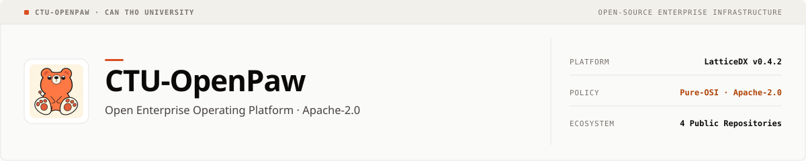
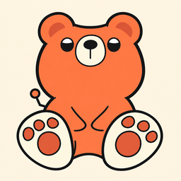
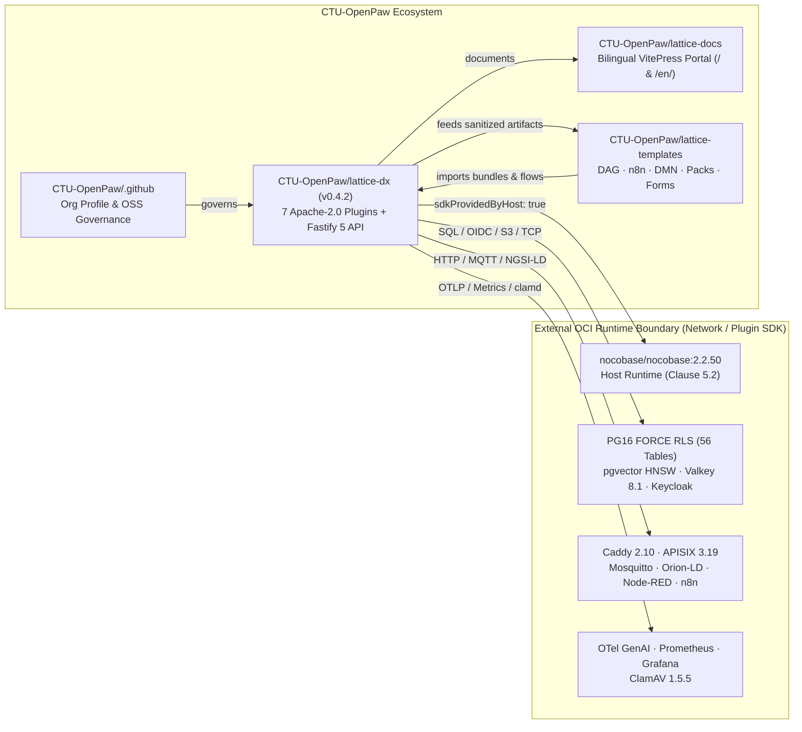
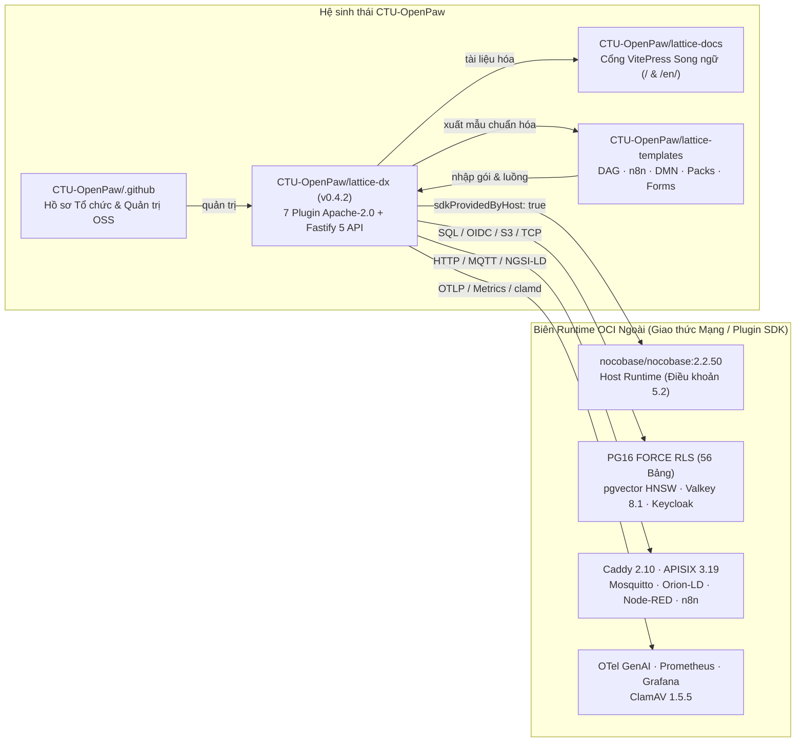

<picture>
  <source media="(prefers-color-scheme: dark)" srcset="https://raw.githubusercontent.com/CTU-OpenPaw/.github/main/assets/org-banner-dark.svg" />
  <source media="(prefers-color-scheme: light)" srcset="https://raw.githubusercontent.com/CTU-OpenPaw/.github/main/assets/org-banner-light.svg" />
  
</picture>

 

<h1>CTU-OpenPaw</h1>

  <strong>A CTU student team building Pure-OSI open-source enterprise systems</strong> 
  <em>Đội ngũ sinh viên Đại học Cần Thơ (CTU) xây dựng hệ thống doanh nghiệp nguồn mở chuẩn Pure-OSI · OLP PMNM 2026</em>

  <a href="#english"><strong>English</strong></a>
  &nbsp;·&nbsp;
  <a href="#tieng-viet"><strong>Tiếng Việt</strong></a>

  <a href="https://github.com/CTU-OpenPaw/lattice-dx">Core Repo (<code>lattice-dx</code>)</a>
  &nbsp;•&nbsp;
  <a href="https://ctu-openpaw.github.io/lattice-docs/">Live Docs (Tiếng Việt)</a>
  &nbsp;•&nbsp;
  <a href="https://ctu-openpaw.github.io/lattice-docs/en/">Live Docs (English)</a>
  &nbsp;•&nbsp;
  <a href="https://github.com/CTU-OpenPaw/lattice-templates">Templates</a>
  &nbsp;•&nbsp;
  <a href="https://github.com/CTU-OpenPaw/.github/blob/main/SECURITY.md">Security</a>
  &nbsp;•&nbsp;
  <a href="https://github.com/CTU-OpenPaw/.github/blob/main/CONTRIBUTING.md">Contributing</a>

  
  
  
  
  

  
  
  
  

---

## English

### Mission & Overview

**CTU-OpenPaw** is a student engineering team at **Can Tho University (CTU / Đại học Cần Thơ)** building **Pure-OSI open-source enterprise systems** for the **OLP PMNM 2026 (VFOSSA)** Open-Source Software Olympiad.

Our flagship platform, [**LatticeDX (`v0.4.2`)**](https://github.com/CTU-OpenPaw/lattice-dx), unifies multi-role low-code portals, DAG workflow orchestration (`LatticeFlow v2`), visual DMN decision tables, cold-chain OMS/WMS/FEFO with Ed25519 QR verification, 2-way IIoT Digital Twin, P.A.R.A. hybrid RAG knowledge vault, and an audited multi-agent AI workforce (MCP + A2A) atop strict multi-tenant PostgreSQL 16 `FORCE ROW LEVEL SECURITY`.

### 4-Repository Ecosystem Architecture

| Repository | Role in Ecosystem | License | Links |
| :--- | :--- | :--- | :--- |
| **[`CTU-OpenPaw/lattice-dx`](https://github.com/CTU-OpenPaw/lattice-dx)** | Core DX-OS platform (`v0.4.2`): 7 NocoBase plugins, Fastify 5 companion API, Compose stacks, PITR/DR, SBOM & PoF verification scripts | `Apache-2.0` | [Repository](https://github.com/CTU-OpenPaw/lattice-dx) · [Releases](https://github.com/CTU-OpenPaw/lattice-dx/releases) |
| **[`CTU-OpenPaw/lattice-docs`](https://github.com/CTU-OpenPaw/lattice-docs)** | Bilingual VitePress documentation portal (Vietnamese root `/` & English `/en/`): architecture, modules, API/RLS security, operations & OSS governance | `Apache-2.0` (VitePress `MIT`) | [Live Portal (EN)](https://ctu-openpaw.github.io/lattice-docs/en/) · [Live Portal (VI)](https://ctu-openpaw.github.io/lattice-docs/) · [Source](https://github.com/CTU-OpenPaw/lattice-docs) |
| **[`CTU-OpenPaw/lattice-templates`](https://github.com/CTU-OpenPaw/lattice-templates)** | Curated, sanitized blueprints: LatticeFlow v2 DAGs, stock `n8n` workflows, DMN decision tables, business packs, public forms & Solution Bundle v3 | `Apache-2.0` | [Repository](https://github.com/CTU-OpenPaw/lattice-templates) |
| **[`CTU-OpenPaw/.github`](https://github.com/CTU-OpenPaw/.github)** | Organization profile showcase, shared brand assets, and org-wide Pure-OSI security, conduct & contribution standards | `Apache-2.0` | [Org Profile](https://github.com/CTU-OpenPaw) · [Repository](https://github.com/CTU-OpenPaw/.github) |

### Pure-OSI Open-Source Commitment & NocoBase `2.2.50` Clause 5.2

Every repository in `CTU-OpenPaw` enforces a verifiable **Pure-OSI** boundary audited on every pull request:

- **100% Pure-OSI `Apache-2.0` Core:** Zero `BSL-1.1`, zero ThingsBoard, zero EMQX, zero `upstream/nocobase` Git submodules, and zero `.gitmodules`.
- **7 Modular Apache-2.0 Plugins (`"sdkProvidedByHost": true`):** `@latticedx/plugin-lattice-foundation`, `@latticedx/plugin-enterprise-auth`, `@latticedx/plugin-action-bridge`, `@latticedx/plugin-dxos-para`, `@latticedx/plugin-dxos-blocks`, `@latticedx/plugin-dxos-studio`, and `@latticedx/plugin-dxos-ai` compile against host contracts without bundling or modifying upstream NocoBase source.
- **External OCI Host & NocoBase `2.2.50` Clause 5.2:** `nocobase/nocobase:2.2.50` is consumed strictly as a pinned external OCI container (`@sha256:`), and Clause 5.2 attribution (`Powered by NocoBase`, `v2.2.50`, `https://www.nocobase.com`, `License settings`) is preserved across the UI and governance files.
- **CycloneDX 1.5 SBOM (`257/257`):** All `257` workspace (`12`), npm (`226`), and OCI (`19`) components have resolved licenses with **`0` `NONE`** and **`0` `BSL-1.1`**.

### Technology Stack Matrix

  
  
  
  
  
  
  
  
  
  
  
  
  
  

| Layer | Technologies | Notes |
| :--- | :--- | :--- |
| **Runtime & Language** | **Node 24** (`>=24 <25`), **pnpm 10.23**, **TypeScript**, **Fastify 5** | ESM monorepo with companion `/v1/*` API & OpenAPI 3.1 / AsyncAPI 3.0 contracts |
| **Low-Code Host & UI** | **NocoBase `2.2.50`** (external OCI), **12 Native v2 BlockModels**, **VitePress** | `"sdkProvidedByHost": true`; Clause 5.2 preserved; bilingual VitePress docs |
| **Data, Cache & Auth** | **PostgreSQL 16 + `pgvector` HNSW**, **Valkey 8.1**, **Keycloak OIDC/PKCE** | `56` static `FORCE RLS` tables + dynamic `latticeCustom*`; pure-OSI BSD-3 Valkey |
| **Zero-Trust Edge & IIoT** | **Caddy + APISIX**, **Mosquitto DynSec + Orion-LD + Node-RED**, **Stock `n8n` 2.48.1** | Mutual/isolated Docker networks, MQTT ACL per tenant, 2-way Digital Twin & optional external `n8n` |
| **Observability & Malware Scan** | **OTel GenAI + Prometheus + Grafana**, **ClamAV 1.5.5** | `gen_ai.*` trace spans, PII redaction, alerting & streaming attachment scanning |

### Verified `v0.4.2` Engineering Metrics

| Metric | Verified Result | Verification Basis |
| :--- | :--- | :--- |
| **Unit & Integration Tests** | **`2,509` passing** (`1,128` Vitest + `1,381` Node `node --test`) | Executed across 152 Vitest files + 174 `node --test` suites (`0` failures) |
| **Live Docker E2E Suite** | **`124/124` passing** | Full Playwright & API multi-portal E2E suite on `v0.4.2` |
| **Vietnamese NL Agent Eval** | **`163/163` (`100%`)** | `node scripts/eval-vietnamese-nl-agent.mjs --min-pass=95` (23 categories incl. 30 security-refusal) |
| **CycloneDX 1.5 SBOM** | **`257/257` resolved (`0 NONE`)** | `pnpm release:sbom -- --check` (`workspace=12, npm=226, oci=19`, `0` BSL-1.1) |
| **PostgreSQL Multi-Tenant Isolation** | **`56` static `FORCE RLS` tables** | Verified in `pg-rls.js` + non-superuser `nocobase_app` + dynamic `latticeCustom*` |
| **SPDX Apache-2.0 Source Headers** | **`1,098+` verified files (`1,098` tracked)** | `node scripts/source-headers.mjs --check` (`0` missing / `0` needsReview) |
| **Production Vulnerability Audit** | **`0` production CVEs** | `pnpm audit --prod --audit-level=low` (`No known vulnerabilities found`) |

### Security, Governance & Community

- **Licenses & Attribution:** [`LICENSE`](https://github.com/CTU-OpenPaw/.github/blob/main/LICENSE) · [`NOTICE`](https://github.com/CTU-OpenPaw/.github/blob/main/NOTICE) · [`COPYRIGHT.txt`](https://github.com/CTU-OpenPaw/.github/blob/main/COPYRIGHT.txt)
- **Community & Contribution:** [`CODE_OF_CONDUCT.md`](https://github.com/CTU-OpenPaw/.github/blob/main/CODE_OF_CONDUCT.md) · [`CONTRIBUTING.md`](https://github.com/CTU-OpenPaw/.github/blob/main/CONTRIBUTING.md) · [GitHub Discussions](https://github.com/CTU-OpenPaw/lattice-dx/discussions)
- **Security Policy & Reporting:** [`SECURITY.md`](https://github.com/CTU-OpenPaw/.github/blob/main/SECURITY.md) · [Report via GitHub Security Advisories](https://github.com/CTU-OpenPaw/lattice-dx/security/advisories/new)

---

## Tiếng Việt

### Sứ mệnh & Tổng quan

**CTU-OpenPaw** là đội ngũ sinh viên **Trường Đại học Cần Thơ (CTU)** phát triển các hệ thống doanh nghiệp nguồn mở chuẩn **Pure-OSI** phục vụ kỳ thi **Olympic Tin học Sinh viên Việt Nam — Phần mềm Nguồn mở (OLP PMNM 2026 / VFOSSA)**.

Sản phẩm cốt lõi [**LatticeDX (`v0.4.2`)**](https://github.com/CTU-OpenPaw/lattice-dx) hợp nhất cổng vận hành đa vai trò (Low-Code/No-Code), công cụ điều phối luồng DAG (`LatticeFlow v2`), bảng quyết định trực quan DMN, chuỗi cung ứng lạnh OMS/WMS/FEFO kèm xác thực QR Ed25519, bản sao số IIoT 2 chiều (Digital Twin), kho tri thức P.A.R.A. Hybrid RAG và đội ngũ tác nhân AI được quản trị (MCP + A2A) trên nền cô lập đa tenant PostgreSQL 16 `FORCE ROW LEVEL SECURITY`.

### Kiến trúc Hệ sinh thái 4 Kho mã nguồn

| Kho mã nguồn | Vai trò trong Hệ sinh thái | Giấy phép | Liên kết |
| :--- | :--- | :--- | :--- |
| **[`CTU-OpenPaw/lattice-dx`](https://github.com/CTU-OpenPaw/lattice-dx)** | Nền tảng DX-OS cốt lõi (`v0.4.2`): 7 plugin NocoBase, Fastify 5 companion API, Compose stacks, PITR/DR, bộ kiểm tra SBOM & PoF | `Apache-2.0` | [Kho mã nguồn](https://github.com/CTU-OpenPaw/lattice-dx) · [Bản phát hành](https://github.com/CTU-OpenPaw/lattice-dx/releases) |
| **[`CTU-OpenPaw/lattice-docs`](https://github.com/CTU-OpenPaw/lattice-docs)** | Cổng tài liệu VitePress song ngữ (`/` Tiếng Việt & `/en/` English): kiến trúc, phân hệ, bảo mật API/RLS, vận hành & quản trị nguồn mở | `Apache-2.0` (VitePress `MIT`) | [Tài liệu (VI)](https://ctu-openpaw.github.io/lattice-docs/) · [Tài liệu (EN)](https://ctu-openpaw.github.io/lattice-docs/en/) · [Mã nguồn](https://github.com/CTU-OpenPaw/lattice-docs) |
| **[`CTU-OpenPaw/lattice-templates`](https://github.com/CTU-OpenPaw/lattice-templates)** | Kho mẫu chuẩn hóa & làm sạch: blueprint LatticeFlow v2, workflow `n8n` chuẩn, bảng DMN, Business Packs, Public Forms & Solution Bundle v3 | `Apache-2.0` | [Kho mã nguồn](https://github.com/CTU-OpenPaw/lattice-templates) |
| **[`CTU-OpenPaw/.github`](https://github.com/CTU-OpenPaw/.github)** | Hồ sơ tổ chức song ngữ, tài nguyên nhận diện thương hiệu và chuẩn bảo mật, ứng xử, đóng góp Pure-OSI toàn tổ chức | `Apache-2.0` | [Hồ sơ Tổ chức](https://github.com/CTU-OpenPaw) · [Kho mã nguồn](https://github.com/CTU-OpenPaw/.github) |

### Cam kết Nguồn mở Pure-OSI & Điều khoản 5.2 NocoBase `2.2.50`

Mọi kho mã nguồn thuộc `CTU-OpenPaw` đều tuân thủ ranh giới **Pure-OSI** có thể kiểm chứng tự động trên từng Pull Request:

- **100% Cốt lõi Pure-OSI `Apache-2.0`:** Không dùng `BSL-1.1`, không ThingsBoard, không EMQX, không submodule `upstream/nocobase` và không `.gitmodules`.
- **7 Plugin Apache-2.0 (`"sdkProvidedByHost": true`):** `@latticedx/plugin-lattice-foundation`, `@latticedx/plugin-enterprise-auth`, `@latticedx/plugin-action-bridge`, `@latticedx/plugin-dxos-para`, `@latticedx/plugin-dxos-blocks`, `@latticedx/plugin-dxos-studio` và `@latticedx/plugin-dxos-ai` chỉ sử dụng hợp đồng SDK từ host lúc chạy, không sao chép hay sửa đổi mã nguồn NocoBase.
- **Host OCI Ngoài & Điều khoản 5.2 NocoBase `2.2.50`:** Ảnh container `nocobase/nocobase:2.2.50` được chạy độc lập qua `@sha256:` và giữ nguyên vẹn ghi nhận thuộc tính theo Điều khoản 5.2 (`Powered by NocoBase`, `v2.2.50`, `https://www.nocobase.com`, `License settings`) trên giao diện và tài liệu pháp lý.
- **CycloneDX 1.5 SBOM (`257/257`):** Toàn bộ `257` thành phần (`workspace=12`, `npm=226`, `oci=19`) đều phân giải rõ giấy phép, **`0` `NONE`** và **`0` `BSL-1.1`**.

### Ma trận Công nghệ (Technology Stack)

  
  
  
  
  
  
  
  
  
  
  
  
  
  

| Tầng kiến trúc | Công nghệ sử dụng | Ghi chú triển khai |
| :--- | :--- | :--- |
| **Runtime & Ngôn ngữ** | **Node 24** (`>=24 <25`), **pnpm 10.23**, **TypeScript**, **Fastify 5** | Monorepo ESM kèm dịch vụ `/v1/*` và đặc tả OpenAPI 3.1 / AsyncAPI 3.0 |
| **Host Low-Code & Tài liệu** | **NocoBase `2.2.50`** (OCI ngoài), **12 Native v2 BlockModels**, **VitePress** | `"sdkProvidedByHost": true`; giữ Điều khoản 5.2; cổng tài liệu VitePress song ngữ |
| **Dữ liệu, Cache & Định danh** | **PostgreSQL 16 + `pgvector` HNSW**, **Valkey 8.1**, **Keycloak OIDC/PKCE** | `56` bảng tĩnh `FORCE RLS` + bảng động `latticeCustom*`; Valkey chuẩn BSD-3 |
| **Biên Zero-Trust & IIoT** | **Caddy + APISIX**, **Mosquitto DynSec + Orion-LD + Node-RED**, **Stock `n8n` 2.48.1** | Mạng Docker cô lập, ACL MQTT từng tenant, Digital Twin 2 chiều & `n8n` tùy chọn ngoài lõi |
| **Giám sát & Quét mã độc** | **OTel GenAI + Prometheus + Grafana**, **ClamAV 1.5.5** | Span `gen_ai.*`, che PII tự động, cảnh báo Prometheus & quét tệp `clamd` |

### Chỉ số Kỹ thuật Đã kiểm chứng (`v0.4.2`)

| Hạng mục kiểm chứng | Kết quả xác nhận | Căn cứ xác minh |
| :--- | :--- | :--- |
| **Kiểm thử Đơn vị & Tích hợp** | **`2,509` ca đạt** (`1,128` Vitest + `1,381` Node `node --test`) | Chạy qua 152 tệp Vitest + 174 bộ kiểm thử `node --test` (`0` lỗi) |
| **Kiểm thử E2E trên Docker thực** | **`124/124` đạt** | Bộ Playwright & API E2E đa cổng toàn hệ thống trên phiên bản `v0.4.2` |
| **Đánh giá AI Tiếng Việt Tự nhiên** | **`163/163` (`100%`)** | `node scripts/eval-vietnamese-nl-agent.mjs --min-pass=95` (23 nhóm gồm 30 ca từ chối bảo mật) |
| **CycloneDX 1.5 SBOM** | **`257/257` thành phần (`0 NONE`)** | `pnpm release:sbom -- --check` (`workspace=12, npm=226, oci=19`, `0` BSL-1.1) |
| **Cô lập Đa tenant PostgreSQL 16** | **`56` bảng tĩnh `FORCE RLS`** | Xác minh tại `pg-rls.js` + vai trò không đặc quyền `nocobase_app` + `latticeCustom*` |
| **Tiêu đề Bản quyền SPDX Apache-2.0** | **`1,098+` tệp đạt chuẩn (`1,098` tệp theo dõi)** | `node scripts/source-headers.mjs --check` (`0` thiếu / `0` cần rà soát) |
| **Rà soát Lỗ hổng Production** | **`0` lỗ hổng (CVE)** | `pnpm audit --prod --audit-level=low` (`No known vulnerabilities found`) |

### Bảo mật, Quản trị Nguồn mở & Cộng đồng

- **Giấy phép & Ghi nhận Nguồn gốc:** [`LICENSE`](https://github.com/CTU-OpenPaw/.github/blob/main/LICENSE) · [`NOTICE`](https://github.com/CTU-OpenPaw/.github/blob/main/NOTICE) · [`COPYRIGHT.txt`](https://github.com/CTU-OpenPaw/.github/blob/main/COPYRIGHT.txt)
- **Quy tắc Ứng xử & Đóng góp:** [`CODE_OF_CONDUCT.md`](https://github.com/CTU-OpenPaw/.github/blob/main/CODE_OF_CONDUCT.md) · [`CONTRIBUTING.md`](https://github.com/CTU-OpenPaw/.github/blob/main/CONTRIBUTING.md) · [Thảo luận Cộng đồng (Discussions)](https://github.com/CTU-OpenPaw/lattice-dx/discussions)
- **Chính sách & Báo cáo Bảo mật:** [`SECURITY.md`](https://github.com/CTU-OpenPaw/.github/blob/main/SECURITY.md) · [Gửi báo cáo qua GitHub Security Advisories](https://github.com/CTU-OpenPaw/lattice-dx/security/advisories/new)

---

  
    <strong>CTU-OpenPaw</strong> · Can Tho University (Đại học Cần Thơ) · OLP PMNM 2026 
    Pure-OSI <code>Apache-2.0</code> · Current Codebase <code>0.4.2</code> (Latest Release <code>v0.4.1</code>, <code>0.4.x</code> series) · External Host Attribution: Powered by NocoBase <code>2.2.50</code> (Clause 5.2)
  

