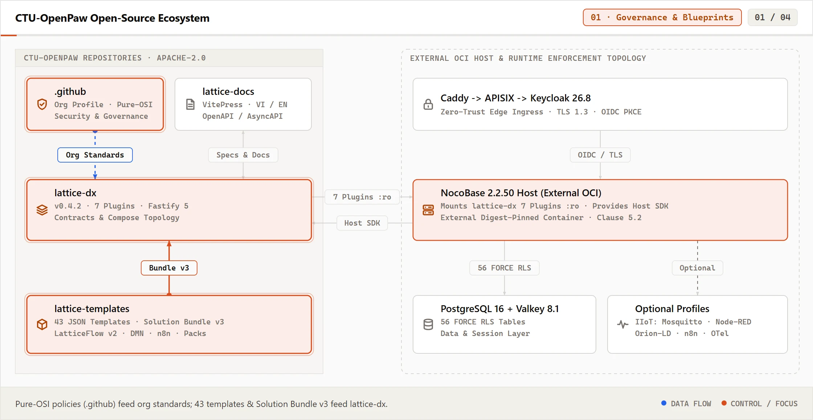

<picture>
  <source media="(prefers-color-scheme: dark)" srcset="https://raw.githubusercontent.com/CTU-OpenPaw/.github/main/assets/org-banner-dark.svg" />
  <source media="(prefers-color-scheme: light)" srcset="https://raw.githubusercontent.com/CTU-OpenPaw/.github/main/assets/org-banner-light.svg" />
  
</picture>

 

  
  
  

  <a href="https://ctu-openpaw.github.io/lattice-docs/">Documentation</a>
  &nbsp;·&nbsp;
  <a href="https://github.com/CTU-OpenPaw/lattice-dx">Platform</a>
  &nbsp;·&nbsp;
  <a href="https://github.com/CTU-OpenPaw/lattice-templates">Templates</a>
  &nbsp;·&nbsp;
  <a href="https://github.com/CTU-OpenPaw/lattice-dx/discussions">Discussions</a>
  &nbsp;·&nbsp;
  <a href="https://github.com/CTU-OpenPaw/.github/blob/main/SECURITY.md">Security</a>

**CTU-OpenPaw** is an engineering organization at Can Tho University building open-source enterprise infrastructure under the Apache-2.0 license. Its core platform, [**LatticeDX (`v0.4.2`)**](https://github.com/CTU-OpenPaw/lattice-dx), pairs seven host-bound NocoBase plugins and a Fastify 5 API with PostgreSQL 16 `FORCE ROW LEVEL SECURITY`, DAG/DMN workflow orchestration, IIoT digital twins, and audited AI agent runtimes.

> **Tiếng Việt:** **CTU-OpenPaw** (Trường Đại học Cần Thơ) phát triển hạ tầng doanh nghiệp nguồn mở chuẩn **Pure-OSI** theo giấy phép **Apache-2.0**, với nền tảng lõi [**LatticeDX (`v0.4.2`)**](https://github.com/CTU-OpenPaw/lattice-dx) tích hợp 7 plugin NocoBase, cô lập dữ liệu PostgreSQL 16 `FORCE RLS`, điều phối quy trình DAG/DMN, bản sao số IIoT và tác nhân AI có kiểm soát. Xem [cổng tài liệu tiếng Việt tại LatticeDocs](https://ctu-openpaw.github.io/lattice-docs/).

## Ecosystem Architecture

  <picture>
    <source media="(prefers-color-scheme: dark)" srcset="https://raw.githubusercontent.com/CTU-OpenPaw/.github/main/assets/ecosystem-dark.webp" />
    <source media="(prefers-color-scheme: light)" srcset="https://raw.githubusercontent.com/CTU-OpenPaw/.github/main/assets/ecosystem-light.webp" />
    
  </picture>

## Repositories

| Repository | Purpose | Stack / License | Links |
| :--- | :--- | :--- | :--- |
| [`CTU-OpenPaw/lattice-dx`](https://github.com/CTU-OpenPaw/lattice-dx) | Core DX-OS platform (`v0.4.2`): seven host-bound plugins, Fastify 5 API, Compose stacks, PITR/DR, and SBOM verification | `Node 24 · TypeScript · PG16` / `Apache-2.0` | [Code](https://github.com/CTU-OpenPaw/lattice-dx) · [Releases](https://github.com/CTU-OpenPaw/lattice-dx/releases) |
| [`CTU-OpenPaw/lattice-docs`](https://github.com/CTU-OpenPaw/lattice-docs) | Bilingual documentation portal (`/` Vietnamese, `/en/` English) covering architecture, APIs, RLS, IIoT, and operations | `VitePress (MIT)` / `Apache-2.0` | [Docs (VI)](https://ctu-openpaw.github.io/lattice-docs/) · [Docs (EN)](https://ctu-openpaw.github.io/lattice-docs/en/) · [Source](https://github.com/CTU-OpenPaw/lattice-docs) |
| [`CTU-OpenPaw/lattice-templates`](https://github.com/CTU-OpenPaw/lattice-templates) | Sanitized catalog of LatticeFlow v2 DAGs, stock `n8n` workflows, DMN decision tables, business packs, public forms, and Solution Bundle v3 | `JSON Schema · Node CLI` / `Apache-2.0` | [Code](https://github.com/CTU-OpenPaw/lattice-templates) |
| [`CTU-OpenPaw/.github`](https://github.com/CTU-OpenPaw/.github) | Organization profile, shared brand assets, and Pure-OSI security, conduct, and contribution standards | `Markdown · SVG` / `Apache-2.0` | [Profile](https://github.com/CTU-OpenPaw) · [Source](https://github.com/CTU-OpenPaw/.github) |

## Open-Source Commitment

1. Apache-2.0 Source & Pure-OSI Boundary: All first-party code, plugins, templates, and documentation carry [`Apache-2.0`](https://github.com/CTU-OpenPaw/.github/blob/main/LICENSE) licensing with zero `BSL-1.1` dependencies and zero `upstream/nocobase` submodules, as documented in [`NOTICE`](https://github.com/CTU-OpenPaw/.github/blob/main/NOTICE).
2. NocoBase `2.2.50` Clause 5.2 Attribution: The seven `@latticedx/*` plugins declare `"sdkProvidedByHost": true` against a pinned external `nocobase/nocobase:2.2.50` OCI container while preserving `"Powered by NocoBase"` UI attribution.
3. Security & Governance: Vulnerability disclosures follow [`SECURITY.md`](https://github.com/CTU-OpenPaw/.github/blob/main/SECURITY.md) via [GitHub Security Advisories](https://github.com/CTU-OpenPaw/lattice-dx/security/advisories/new), and contributions follow [`CONTRIBUTING.md`](https://github.com/CTU-OpenPaw/.github/blob/main/CONTRIBUTING.md) and [`CODE_OF_CONDUCT.md`](https://github.com/CTU-OpenPaw/.github/blob/main/CODE_OF_CONDUCT.md).

---

  CTU-OpenPaw · Can Tho University · Apache-2.0 · Powered by NocoBase v2.2.50 (Clause 5.2)

